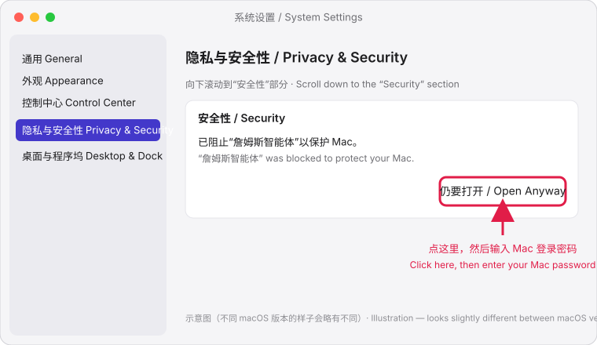

# 安装说明 / Installation guide（测试版 0.3.0）

> 这是测试版安装包，还没有做苹果公证和微软代码签名，所以第一次打开时系统会拦一下，按下面的步骤放行一次即可，之后正常打开。
> This is a test build. It is not notarized by Apple or code-signed for Windows yet, so the system blocks the first launch once. Follow the steps below; after that it opens normally.

---

## Mac（macOS 14 及以上）

安装包：`JamesAgent-0.3.0-mac-arm64.dmg`（Apple 芯片：M1 / M2 / M3 / M4…）。本次不提供 Intel Mac 安装包。

### 中文步骤

1. 双击打开 `.dmg`，在弹出的窗口里把 **詹姆斯智能体** 拖到右边的 **“应用程序”** 文件夹。
2. 打开“应用程序”文件夹，双击 **詹姆斯智能体**。第一次会被拦下（提示“无法打开”或“未打开”），点 **完成** / **好**。
3. 打开 **系统设置** → 左边点 **隐私与安全性** → 向下滚动到 **安全性** 部分，会看到“已阻止‘詹姆斯智能体’以保护 Mac”。
4. 点旁边的 **仍要打开**，在弹出的确认框里再点 **仍要打开**，然后输入 **Mac 的登录密码**。
5. 软件打开，之后双击就能正常打开，不会再拦。

### English steps

1. Double-click the `.dmg`. In the window that opens, drag **詹姆斯智能体 (James Agent)** onto the **Applications** folder on the right.
2. Open the Applications folder and double-click **詹姆斯智能体**. The first launch is blocked (“cannot be opened” / “not opened”) — click **Done** / **OK**.
3. Open **System Settings** → **Privacy & Security** in the sidebar → scroll down to **Security**. You will see “‘詹姆斯智能体’ was blocked to protect your Mac”.
4. Click **Open Anyway**, confirm with **Open Anyway** again, then enter your **Mac password**.
5. The app opens. From now on it opens normally with a double-click.

---

## Windows（Windows 10 / 11，64 位）

安装包：`JamesAgent-Setup-0.3.0.exe`

### 中文步骤

1. 双击 `JamesAgent-Setup-0.3.0.exe`。出现蓝色窗口“Windows 已保护你的电脑”时，点 **更多信息** → **仍要运行**。
2. 按安装向导点 **下一步** 完成安装（装在当前用户下，不需要管理员权限），可以勾选“创建桌面快捷方式”。
3. 从开始菜单或桌面打开 **詹姆斯智能体**。

### English steps

1. Double-click `JamesAgent-Setup-0.3.0.exe`. When the blue “Windows protected your PC” (SmartScreen) window appears, click **More info** → **Run anyway**.
2. Click through the setup wizard (installs for the current user, no administrator rights needed); optionally tick “Create a desktop shortcut”.
3. Open **詹姆斯智能体** from the Start menu or the desktop.

---

## 第一次打开 / First launch

- 软件在自己的窗口里打开，所有数据只保存在这台电脑上：
  Mac `~/Library/Application Support/JamesAgent`，Windows `%APPDATA%\JamesAgent`。卸载软件不会删除这些数据。
  The app opens in its own window; all data stays on this computer (folders above). Uninstalling does not delete it.
- 第一次打开时会在后台下载 **浏览器组件**（下载约 250 MB，左下角显示进度）。下载完成前，“登录官网后读取”和“隐身模式”会提示稍等，其他功能照常使用。下载失败可以在左下角点“重试”。
  On first launch a **browser component** (about 250 MB) downloads in the background — progress is shown at the bottom left. Until it finishes, “read after logging in” and stealth mode wait; everything else works. If it fails, click “Retry” at the bottom left.
- 本机语义模型（约 235 MB）在第一次需要时自动下载。The local semantic model (~235 MB) downloads automatically the first time it is needed.
- **关闭窗口不会退出软件**：监控、找客户、定时推送在后台继续。Mac 屏幕右上角菜单栏、Windows 右下角托盘里有软件图标：点它可以重新打开窗口、暂停 / 继续所有 AI、退出（退出前会确认，退出后定时任务停止；Mac 上按 Cmd+Q 也一样先确认）。图标上有红点 = 有紧急提醒没处理。
  **Closing the window does not quit the app** — monitoring, prospecting and scheduled push keep running. Use the icon in the Mac menu bar (top right) or the Windows tray (bottom right) to reopen the window, pause / resume all AIs, or quit (asks first; scheduled work stops after quitting — Cmd+Q on the Mac asks too). A red dot on the icon means an urgent alert is open.
- 先想看看效果：快速开始第 2 步点 **“先用测试模式看看（不花钱）”**。To try it without an API key, choose **test mode** in quick-start step 2.
